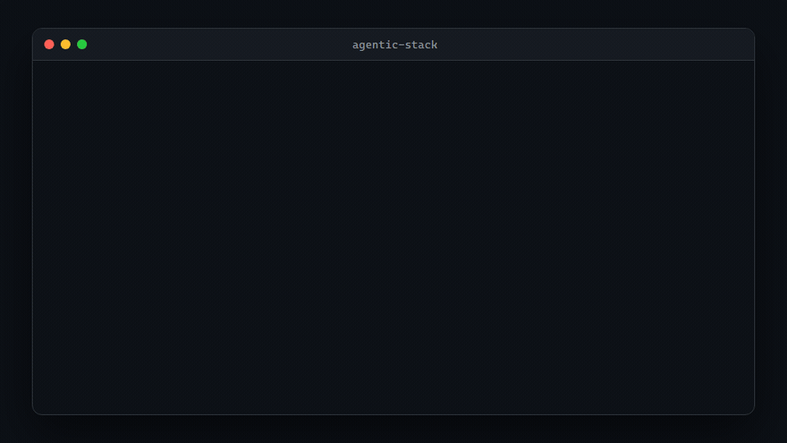

# agentic-stack

[](https://www.npmjs.com/package/agentic-stack)
[](https://github.com/m-ishfaq/agentic-stack/actions/workflows/ci.yml)
[](LICENSE)

One command gives any project a safe, consistent AI coding setup: rules, skills, hooks, policies, and tool adapters.



```bash
npx agentic-stack@latest init
```

Node 20 or newer. No global install. No telemetry.

Works with Claude Code, Cursor, Copilot, Codex, Gemini, Cline, Devin, and Aider. The core install is tool-neutral: `AGENTS.md` and `.agents/` work even when you select no adapter.

## Why

AI agents are fast, but they are not careful by default. They commit, push, read `.env`, run migrations, and reach outside the project.

Prompt files alone do not stop that. `agentic-stack` adds enforcement, so safety does not depend on the model remembering a rule.

The agent can still do normal work. It cannot do the things that lose data or leak secrets.

## Quick start

```bash
# inside your project
npx agentic-stack@latest init

# non-interactive, all adapters
npx agentic-stack@latest init --yes

# neutral, only AGENTS.md and .agents/
npx agentic-stack@latest init --yes --adapters none

# pick adapters and a stack pack
npx agentic-stack@latest init --adapters claude,cursor --packs typescript

# see the plan first
npx agentic-stack@latest init --dry-run
```

Add CI or a devcontainer only when you want them:

```bash
npx agentic-stack@latest init --yes --ci --devcontainer
```

Then commit the setup. The CLI prints the exact `git add` line for your adapters:

```bash
git add .agents AGENTS.md agentic.config.json .agentic
```

The agent never commits or pushes. You keep git.

## What lands in your project

```text
AGENTS.md                  short always-on router for any agent
.agents/
  project.md               project brain: domain rules, users, layout, services
  rules/                   response, workflow, quality, testing, git, security, docs, context, data
  skills/<name>/SKILL.md   procedures, loaded only when needed
  agents/                  review and security subagent definitions
  commands/                /spec /plan /build /review /test /fix /ship /handoff
  hooks/                   portable Node scripts, no bash-only code
  policies/deny.json       deny, ask, scope, and test database rules
  scripts/test-safe.mjs    test runner that refuses dev and prod databases
  mcp.json                 opt-in MCP servers, never seeded with one
  templates/               spec, plan, ADR, PR, bug, handoff
  memory/                  decisions and current task state
agentic.config.json        adapters, packs, extras, budgets
.agentic/lock.json         template version and file hashes
```

`AGENTS.md` and `.agents/` are the source of truth. Tool files are generated from them and carry a "do not edit" header.

A fresh install with no existing tool folders writes every supported adapter. That way Claude, Cursor, Copilot, Codex, Gemini, Cline, Devin, and Aider all load the rules without extra setup. If tool folders already exist, those tools are used. Pass `--adapters none` for a neutral install with only `AGENTS.md` and `.agents/`.

| Tool | Files | Rules | Skills | Commands | Hooks | MCP |
|---|---|---|---|---|---|---|
| Claude Code | `CLAUDE.md` (imports AGENTS.md), `.claude/settings.json`, `.claude/rules/`, `.claude/agents/` | yes | yes | yes | yes | `.mcp.json` |
| Cursor | `.cursor/rules/`, `.cursor/mcp.json` | yes | via rules | no | no | yes |
| GitHub Copilot | `.github/copilot-instructions.md`, `.github/instructions/` | yes | no | no | no | editor |
| Codex | `AGENTS.md`, `.agents/skills/`, `.codex/config.toml` | yes | yes | no | no | yes |
| Gemini | `GEMINI.md`, `.gemini/commands/`, `.gemini/settings.json` | yes | yes | yes | no | yes |
| Cline | `AGENTS.md`, `.clinerules/` | yes | no | no | no | no |
| Devin | `.devin/rules/` (Windsurf fallback) | yes | no | no | no | no |
| Aider | `CONVENTIONS.md`, `.aider.conf.yml` | yes | manual | no | git | no |

No provider supports every surface, so the installer writes only what the tool reads. MCP files are written only when `.agents/mcp.json` contains a server. Everything lives in `.agents/`, so switching tools later loses nothing. `agentic doctor` prints this table for the adapters you selected.

## Safety model

Every rule exists twice: as guidance, then as enforcement.

| Layer | What it does |
|---|---|
| Rules | how the agent plans, answers, and reviews its own work |
| Hooks | block off-limits commands and paths before they run |
| Policy file | one deny, ask, and allow list, translated per tool |
| Test runner | throwaway database only, refuses dev or prod targets |
| CI (opt-in) | verifies installed files and policy are intact |
| Devcontainer (opt-in) | project-only access, no home secrets, no host database |

Denied at every strictness level:

- git writes: add, commit, push, tag, merge, rebase, reset, checkout, stash, branch delete
- `.env` and secret files: `.env`, `.env.*`, `*.pem`, `*.key`, `**/secrets/**`
- databases: `psql`, `mysql`, `mongosh`, `redis-cli`, `sqlite3`, and database ports
- migrations and seeds, including `prisma db push` and `npm run migrate`
- deploys and publishes: `vercel`, `flyctl`, `npm publish`, `docker push`
- destructive shell: `sudo`, `rm -rf`, `chmod 777`
- any path outside the project root

## Strictness

Set once in `agentic.config.json`. It controls what happens when the policy says "ask", such as `npm install` or edits to `package.json`.

| Level | Ask list |
|---|---|
| `strict` (default) | blocked |
| `balanced` | reported, then allowed |
| `loose` | ignored |

Hard denials above never change with the level.

## Commands

```bash
agentic init [dir]        install into a project
agentic sync [dir]        regenerate tool files after editing .agents/
agentic sync --restore    recreate generated files you deleted
agentic upgrade [dir]     take template updates without losing local edits
agentic add <pack> [dir]  add a stack pack later
agentic check [dir]       verify hashes, policy, hooks, and budgets
agentic doctor [dir]      check Node, git, config, and hook files
agentic eject [dir]       remove CLI metadata, keep every installed file
```

`init` flags: `--yes`, `--adapters` (`all`, `none`, or a list), `--packs`, `--strictness`, `--ci`, `--devcontainer`, `--no-gitignore`, `--force`, `--dry-run`.

Existing files are merged or left alone, never silently replaced. `AGENTS.md` gets a managed block, `CLAUDE.md` gets an `@AGENTS.md` import, and JSON settings keep your keys while adding the guard hooks. Files we cannot merge are listed as skipped. `--force` backs up and replaces.

Exit codes: `0` ok, `2` usage, `4` drift or missing files, `5` budget overrun, `6` upgrade conflict.

## Stack packs

Packs add rules for one ecosystem. Install with `--packs`, or later with `agentic add`.

`typescript` `react-next` `python` `go` `php-laravel` `java` `rust` `docker` `monorepo` `mobile`

## Configuration

`agentic.config.json` holds adapters, packs, strictness, budgets, and the commands detected in your project.

```json
{
  "version": 1,
  "project": {
    "name": "my-app",
    "stack": "Laravel (PHP) + Node.js",
    "packageManager": "composer",
    "commands": {
      "install": "composer install",
      "dev": "composer run dev",
      "test": "php artisan test",
      "testSafe": "node .agents/scripts/test-safe.mjs",
      "lint": "vendor/bin/pint --test",
      "typecheck": null,
      "build": null
    }
  },
  "adapters": ["claude", "cursor", "copilot", "codex", "gemini", "cline", "devin", "aider"],
  "packs": ["php-laravel"],
  "extras": { "ci": false, "devcontainer": false },
  "policy": { "strictness": "strict", "scope": "project" },
  "budgets": { "agentsMdLines": 150, "alwaysOnTokens": 4000 }
}
```

Detection covers Node, PHP/Laravel, Python, Go, Rust, and Java, plus common lockfiles. Missing commands stay `null`; templates print `not configured` instead of inventing one. Precedence: CLI flag, config, detection, default. `init` writes the result, so later runs reuse it.

## Upgrading

```bash
npx agentic-stack@latest upgrade
```

Local edits are never overwritten. If you and the template both changed a file, the new version goes to `.agentic/conflicts/<timestamp>/` and the CLI exits `6`. Merge by hand, then run `agentic sync`.

Backups from `--force` and upgrades live in `.agentic/backups/`, which is gitignored.

## Status

Working today: neutral install, eight adapters, ten packs, non-destructive merges, drift checks, guard hooks, safe test runner, upgrade with conflict files, `add`, `eject`, and opt-in CI and devcontainer files.

Planned: a pack registry with checksums, a standalone `agentic-stack/check` GitHub Action, organization template sync, and policy presets. See `docs/06-roadmap.md`.

## The name

`create-agentic-stack` was already taken on npm, so `npm create` was not an option.

`agentic-stack` was free. It says what it is: a stack of agent rules, skills, policies, and adapters for a project. The package is `agentic-stack`, the binary is `agentic`, so the command stays short.

## Repository layout

```text
agentic-stack/
  docs/            design documents
  templates/
    base/          stack-neutral baseline
    packs/         opt-in stack rules
  packages/
    cli/           published package, binary agentic
    core/          detection, generation, adapters, merge
  evals/           agent behavior tests
```

## Development

```bash
git clone https://github.com/m-ishfaq/agentic-stack.git
cd agentic-stack
npm test
npm run eval
node packages/cli/bin/agentic.js init .tmp/demo --yes
```

`npm run demo` rebuilds `docs/demo.gif` from `scripts/demo.html`. It needs Chrome and ffmpeg.

## Design principles

- One source of truth: `.agents/` is canonical, every tool file is generated.
- Portable first: plain Markdown and Node scripts. No bash-only hooks.
- Deny by default: an unknown command is a question, not a permission.
- Small always-on context: router under 150 lines.
- No lock-in: delete the CLI and the setup still works.
- No telemetry. MIT.

## Release

1. Bump `version` in `packages/cli/package.json`, `packages/core/package.json`, and `packages/core/src/version.js`.
2. Commit and push to `main`.
3. Push a matching tag.

```bash
git tag v0.3.0
git push origin v0.3.0
```

The `publish` workflow runs tests and evals, checks the tag against the package version, then publishes with provenance.

Publishing is keyless. Configure npm trusted publishing once:

1. Open the package settings on npmjs.com, then Trusted Publisher.
2. Choose GitHub Actions.
3. Set repository `m-ishfaq/agentic-stack` and workflow `publish.yml`.
4. Enable direct `npm publish`, not only staged publish.

No `NPM_TOKEN` secret is needed. You can also run the workflow manually from the Actions tab; the tag check is skipped on branch runs.

Manual publish:

```bash
cd packages/cli
npm publish --access public
```

## Contributing

Issues and pull requests are welcome at [m-ishfaq/agentic-stack](https://github.com/m-ishfaq/agentic-stack).

Please run `npm test` and `npm run eval` before opening a pull request, and keep changes small and focused.

## Docs

| File | Contents |
|---|---|
| `docs/00-landscape.md` | research, tool support matrix, prior art |
| `docs/01-architecture.md` | layers, adapter model, generation and drift |
| `docs/02-inventory.md` | every rule, skill, command, hook, template |
| `docs/03-response-contract.md` | how the agent answers, verbatim |
| `docs/04-policy-and-test-safety.md` | deny matrix, scope, safe test database |
| `docs/05-cli-and-upgrade.md` | commands, config, lockfile, 3-way merge |
| `docs/06-roadmap.md` | phases, metrics, risks, open questions |

MIT licensed. Copyright (c) 2026 m-ishfaq.
